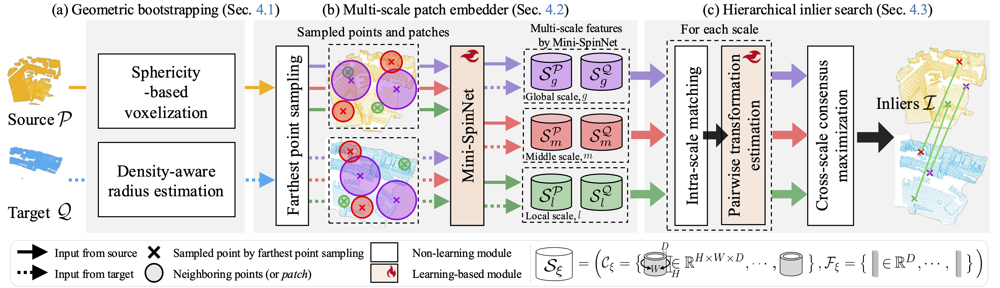

<div align="center">
    <h1>BUFFER-X (ICCV 2025, 🌟Highlight🌟 · TPAMI 2026)</h1>
    <p align="center">
      <strong>ICCV 2025:</strong><br />
      <a href="https://scholar.google.com/citations?user=esoiHnYAAAAJ&hl=en">Minkyun Seo*</a>,
      <a href="https://scholar.google.com/citations?user=S1A3nbIAAAAJ&hl=en">Hyungtae Lim*</a>,
      <a href="https://scholar.google.com/citations?user=s-haNkwAAAAJ&hl=en">Kanghee Lee</a>,
      <a href="https://scholar.google.com/citations?user=U4kKRdMAAAAJ&hl=it">Luca Carlone</a>,
      <a href="https://scholar.google.com/citations?user=_3q6KBIAAAAJ&hl=en">Jaesik Park</a>
      <br />
    </p>
    <a href="https://github.com/MIT-SPARK/BUFFER-X"></a>
    <a href="https://github.com/MIT-SPARK/BUFFER-X"></a>
    <a href="https://arxiv.org/abs/2503.07940">
    
    </a>
    <a href="https://arxiv.org/abs/2601.02759">
    
    </a>
    <a href="https://ieeexplore.ieee.org/document/11651365">
    
    </a>
    <a href="LICENSE"></a>
    <a href="huggingface/model_card/README.md"></a>
  <br />
  <br />
  <p align="center"></p>
  <p><strong><em>Towards zero-shot and beyond! 🚀 <br>
  Official repository of BUFFER-X, a zero-shot point cloud registration method<br> across diverse scenes without retraining or tuning.</em></strong></p>
</div>

________________________________

## 📄 Papers

- **ICCV 2025 (Highlight):** [BUFFER-X: Towards Zero-Shot Point Cloud Registration in Diverse Scenes](https://openaccess.thecvf.com/content/ICCV2025/html/Seo_BUFFER-X_Towards_Zero-Shot_Point_Cloud_Registration_in_Diverse_Scenes_ICCV_2025_paper.html). Minkyun Seo, Hyungtae Lim, Kanghee Lee, Luca Carlone, and Jaesik Park.
- **TPAMI 2026 (journal extension):** [Toward Zero-Shot Point Cloud Registration Across Diverse Scales, Scenes, and Sensor Setups](https://ieeexplore.ieee.org/document/11651365). Hyungtae Lim, Minkyun Seo, Luca Carlone, and Jaesik Park. *IEEE Transactions on Pattern Analysis and Machine Intelligence*, 48(11):15234–15251. [Open-access version](https://arxiv.org/abs/2601.02759).

The journal extension expands evaluation to **12 datasets**, covering object-scale, indoor, and outdoor scenes as well as heterogeneous LiDAR sensor setups. It also introduces **BUFFER-X-Lite**, combining adaptive early exit with a fast, robust pose solver to reduce total computation time by **43%** relative to BUFFER-X while maintaining comparable accuracy in the reported experiments. The descriptor model is trained once and applied without target-domain retraining or parameter tuning.

See the [heterogeneous evaluation instructions](#test-on-our-generalization-benchmark), [KISS-Matcher integration](#using-kiss-matcher-as-the-pose-solver), and [early-exit configuration](#early-exit-confidence-aware-multi-scale-processing) below.

## 🧭 Structure Overview



## 💻 Installation

```bash
git clone https://github.com/MIT-SPARK/BUFFER-X
cd BUFFER-X
conda create -n bufferx python=3.11 -y
conda activate bufferx
./scripts/install.sh --cuda cu124 --with-hub
```

For other CUDA versions and optional dependencies, see the
[installation guide](INSTALL.md).

______________________________________________________________________

## 🚀 Quick Start

### Training and Test

#### Test on Our Generalization Benchmark

Download the pretrained models from Hugging Face:

```bash
python scripts/download_pretrained_models.py --source hf --repo-id Hyungtae-Lim/BUFFER-X
```

Download the preprocessed benchmark data (approximately 130 GB):

```bash
./scripts/download_all_data.sh
```

Then run an evaluation:

```bash
python test.py --dataset 3DMatch TIERS Oxford MIT --experiment_id threedmatch --verbose
```

To evaluate all supported datasets:

```bash
./scripts/eval_all.sh <EXPERIMENT ID>
```

For heterogeneous sensor settings:

```bash
./scripts/eval_all_hetero.sh <EXPERIMENT ID>
```

<details>
  <summary><strong>Evaluation options and datasets</strong></summary>

- `--dataset`: The name of the dataset to test on. Must be one of:

  - `3DMatch`
  - `3DLoMatch`
  - `Scannetpp_iphone`
  - `Scannetpp_faro`
  - `TIERS`
  - `KITTI`
  - `WOD`
  - `MIT`
  - `KAIST`
  - `ETH`
  - `Oxford`
  - `TIERS_hetero`
  - `KAIST_hetero`

- `--experiment_id`: The ID of the experiment to use for testing.

- `--pose_estimator`: Pose estimation backend. Choices: `ransac` (default) or `kiss_matcher`.

- `--gpu`: GPU device index to use (default: `0`).

- `--num_points_per_patch`, `--num_scales`, `--num_fps`, `--search_radius_thresholds`: Override the corresponding config values for ablation studies.

For heterogeneous evaluation, additional arguments are:
- `--src_sensor`: Source sensor name (e.g., `os0_128`, `Aeva`).
- `--tgt_sensor`: Target sensor name (e.g., `os1_64`, `Avia`).

e.g.,

```
python test.py --dataset TIERS_hetero --src_sensor os0_128 --tgt_sensor os1_64 --experiment_id threedmatch --verbose
```


See [dataset/README.md](dataset/README.md) for dataset-specific download and
preprocessing instructions. ScanNet++ data cannot be redistributed.

</details>

______________________________________________________________________

## 🤗 Hugging Face

Pretrained checkpoints are hosted at
[Hyungtae-Lim/BUFFER-X](https://huggingface.co/Hyungtae-Lim/BUFFER-X).
Maintainer upload instructions are in [INSTALL.md](INSTALL.md#publishing-to-hugging-face).

______________________________________________________________________

### Using KISS-Matcher as the Pose Solver

This branch adds support for [KISS-Matcher](https://github.com/MIT-SPARK/KISS-Matcher) as an alternative to RANSAC for the final pose estimation step.

#### Installation

Please follow the official Python installation instructions provided in the KISS-Matcher repository:
https://github.com/MIT-SPARK/KISS-Matcher?tab=readme-ov-file#package-installation

#### Usage

Pass `--pose_estimator kiss_matcher` on the command line:

```bash
python test.py --dataset 3DMatch --experiment_id threedmatch --pose_estimator kiss_matcher --verbose
```

To use RANSAC (default behavior):

```bash
python test.py --dataset 3DMatch --experiment_id threedmatch --pose_estimator ransac --verbose
```

#### Configuration

You can also set the pose estimator and its options directly in the config files (e.g., `config/indoor_config.py`):

```python
cfg.match.pose_estimator = "kiss_matcher"  # "ransac" or "kiss_matcher"
cfg.match.kiss_resolution = 0.3            # Voxel resolution for KISS-Matcher
```

> **Note:** If `kiss-matcher` is not installed, the pipeline automatically falls back to RANSAC with a warning.

______________________________________________________________________

### Early Exit (Confidence-Aware Multi-Scale Processing)

BUFFER-X-Lite, introduced in the TPAMI extension, uses an **incremental multi-scale processing** strategy that stops computing additional scales once the pose estimate is already confident enough. This reduces unnecessary descriptor extraction and speeds up inference.

The early exit is triggered when the number of RANSAC/KISS-Matcher inliers exceeds `early_exit_min_inliers` after the first scale.

#### Configuration

```python
cfg.match.enable_early_exit = False   # Enable confidence-aware early exit (default: False)
cfg.match.early_exit_min_inliers = 50  # Minimum inlier count to trigger early exit
```
______________________________________________________________________

### Output Files

After each test run, results are automatically saved:

- **Per-sample `.txt`**: detailed per-frame metrics (success, RTE, RRE, inlier counts, timing) under `per_sample_results/<exp_name>/`.
- **Summary `.csv`**: aggregated statistics (recall, RTE/RRE mean ± std, timing) saved to the root directory as `full_results/results_<exp_name>_<params>_<timestamp>.csv`.

______________________________________________________________________

#### Training

BUFFER-X supports training on either the **3DMatch** or **KITTI** dataset. As un example, run the following command to train the model:

```
python train.py --dataset 3DMatch
```

______________________________________________________________________

### 📝 Citation

If you find our work useful in your research, please consider citing the ICCV paper and its TPAMI journal extension:

```bibtex
@inproceedings{Seo_2025_ICCV,
  title={BUFFER-X: Towards Zero-Shot Point Cloud Registration in Diverse Scenes},
  author={Seo, Minkyun and Lim, Hyungtae and Lee, Kanghee and Carlone, Luca and Park, Jaesik},
  booktitle={Proceedings of the IEEE/CVF International Conference on Computer Vision (ICCV)},
  year={2025},
  pages={3851--3862}
}
```

```bibtex
@article{Lim_2026_TPAMI,
  title={Toward Zero-Shot Point Cloud Registration Across Diverse Scales, Scenes, and Sensor Setups},
  author={Lim, Hyungtae and Seo, Minkyun and Carlone, Luca and Park, Jaesik},
  journal={IEEE Transactions on Pattern Analysis and Machine Intelligence},
  year={2026},
  volume={48},
  number={11},
  pages={15234--15251},
  month=nov,
  doi={10.1109/TPAMI.2026.3722524},
  url={https://ieeexplore.ieee.org/document/11651365}
}
```

______________________________________________________________________

## 🙏 Acknowledgements

This work was supported by IITP grant (RS-2021-II211343: AI Graduate School Program at Seoul National University) (5%), and by NRF grants funded by the Korea government (MSIT) (No. 2023R1A1C200781211 (65%) and No. RS-2024-00461409 (30%), respectively).

In addition, we appreciate the open-source contributions of previous authors,
and especially thank [Sheng Ao](https://scholar.google.com/citations?user=cvS1yuMAAAAJ&hl=zh-CN), the first author of [BUFFER](https://github.com/SYSU-SAIL/BUFFER),
for allowing us to use the term 'BUFFER' as part of the title of our study.

- [FCGF](https://github.com/chrischoy/FCGF)
- [Vector Neurons](https://github.com/FlyingGiraffe/vnn)
- [D3Feat](https://github.com/XuyangBai/D3Feat.pytorch)
- [PointDSC](https://github.com/XuyangBai/PointDSC)
- [SpinNet](https://github.com/QingyongHu/SpinNet)
- [GeoTransformer](https://github.com/qinzheng93/GeoTransformer)
- [RoReg](https://github.com/HpWang-whu/RoReg)
- [BUFFER](https://github.com/SYSU-SAIL/BUFFER)

______________________________________________________________________

### Updates

- 2026: The [journal extension](https://ieeexplore.ieee.org/document/11651365) is published in **IEEE TPAMI**, introducing BUFFER-X-Lite and an expanded 12-dataset benchmark.
- 03/03/2026: Refactored evaluation/testing code for cleaner structure, improved logging, and more reliable result reporting.
- 28/02/2026: Added **KISS-Matcher** pose solver support and confidence-aware **early exit** for multi-scale processing.
- 06/01/2026: Extended version of the paper has been uploaded.
- 25/07/2025: This work is selected as a **Highlight** paper at ICCV 2025.
- 25/06/2025: This work is accepted by ICCV 2025.
